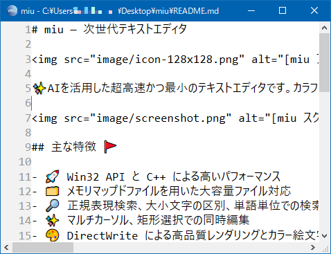

# miu — 次世代テキストエディタ


先進✨の超高速かつ軽量・最小実装のマルチプラットフォーム対応テキスト＆コードエディタ📄です。カラフルな絵文字🎨や多言語テキストに対応し、巨大ファイルの高速編集から Markdown・LaTeX 数式・Mermaid 図表のリアルタイムプレビューまで軽快に動作します。



## 主な特徴 🚩

- 🚀 **ネイティブ実装による圧倒的な高速動作**
  - Windows（C++17 / Win32 / DirectWrite）、macOS（Cocoa / CoreText）、iOS・iPadOS（UIKit / CoreText）、Android（C++20 NDK / Vulkan + FreeType + HarfBuzz）の各 OS に最適化したネイティブ設計
- 🗂 **巨大ファイルの高速編集**
  - メモリマップドファイル等を活用した高速なファイル読み込み・スクロール・一括置換
- 💻 **65言語カテゴリ（230種類以上の拡張子・設定ファイル）のシンタックスハイライト & Emmet 対応**
  - C/C++、C#、Objective-C/C++、Rust、Go、Zig、D、Nim、Swift、Kotlin、Java、Groovy/Gradle、Scala、Python、JavaScript/TypeScript、Ruby、PHP、Perl、Lua、Lisp（Common Lisp / Emacs Lisp / Scheme / Racket / Clojure）、OCaml/SML/ReScript、Haskell、Elixir、Erlang、Fortran、COBOL、Pascal/Delphi、Ada、Prolog、Assembly（x86/x64 / ARM64 / RISC-V / MIPS / WebAssembly `.wat`）、Shader（HLSL / GLSL / Metal）、Solidity、Prisma、Nix、Vimscript、HTML、CSS、Markdown、LaTeX、SQL、JSON、YAML、TOML、Shell、PowerShell、Dockerfile 等に対応
  - HTML / CSS の Emmet 省略記法展開、スマート自動インデント、行コメント切替、対応括弧のハイライトを搭載
- 📊 **完全オフラインのリアルタイム・ライブプレビュー**
  - **Markdown**（GFM テーブル・タスクリスト・コードブロック）・**HTML**・**SVG** の即時プレビュー
  - **LaTeX 数式レンダリング**（インライン `$...$` / `\( ... \)`、ディスプレイ `$$...$$` / `\[ ... \]`）
  - **全33種類の Mermaid 図表**を外部通信なしで SVG 描画（フローチャート、シーケンス図、クラス図、状態遷移図、ER 図、ガントチャート、マインドマップ、C4 図、タイムライン、Git グラフ、XY チャート、サンキー図、アーキテクチャ図、かんばん、ツリーマップ、ベン図、特性要因図、ウォードリーマップ、スイムレーン、鉄道図、イベントモデリング、決定表、ユースケース図、クネビン図など）
- 🔎 **多言語・全角文字に完全対応した検索／置換**
  - UTF-8 マルチバイト文字（日本語・韓国語・中国語・絵文字など）を1文字単位で正確に扱う高速正規表現検索・一括置換（「すべて置換」）、大文字／小文字の区別、単語単位検索
- ✨ **充実した編集サポート**
  - マルチカーソル編集、矩形（ボックス）選択、行の折り返し切り替え（Word Wrap）、行番号表示、空白・タブ・全角スペース・改行記号の可視化、無制限の Undo／Redo
- 🌐 **40種類以上の文字コード自動判別 & 30言語 UI**
  - Google `compact_enc_det` により UTF-8、UTF-16、Shift_JIS、EUC-JP、ISO-2022-JP、GB18030、Big5、EUC-KR 等の文字コードと改行コード（CRLF / LF / CR）を自動判別・変換保存
  - 日本語・英語・中国語（簡体字／繁体字）・韓国語・ドイツ語・フランス語・スペイン語など 30 言語の UI 表示に対応
- 🌙 **ダークモード／ライトモード対応**
- 🔒 **安心のプライバシー・安全設計**
  - 広告表示、トラッキング、外部へのデータ送信は一切なし（100% ローカル完結）

## 対応環境 🖥📱

- **Windows**: Windows 11 / Windows 10 (x64 / Win32)
- **macOS**: macOS 13.0 (Ventura) 以降（Apple Silicon `arm64` / Intel `x86_64` Universal）
- **iOS / iPadOS**: iOS 16.0 / iPadOS 16.0 以降
- **Android**: Android 7.0 (API Level 24) 以降（`arm64-v8a` / `armeabi-v7a` / `x86` / `x86_64`、Vulkan 対応端末）

## 開発環境 🛠

- **Windows**: Visual Studio 2026（C++17 / PlatformToolset `v145`）
- **macOS / iOS / iPadOS**: Xcode 16 以降（Objective-C++ / C++20）
- **Android**: Android Studio / Android SDK (compileSdk 36) / Android NDK / CMake 3.22.1 / JDK 17 以降（C++20）

## ビルド手順 🔧

本プロジェクトは文字コード判定に Google `compact_enc_det` を使用しています（ソースコードおよびビルド済みライブラリはリポジトリ内に同梱されています）。

### 1. Windows 版のビルド

`lib/ced.lib` および `include/compact_enc_det/` が同梱されているため、そのまま Visual Studio または MSBuild でビルドできます。

```powershell
msbuild miu.sln /p:Configuration=Release /p:Platform=x64
```

<details>
<summary><code>ced.lib</code> をソースから再ビルドする場合</summary>

```powershell
git clone https://github.com/google/compact_enc_det.git
cd compact_enc_det
cmake . -G "Visual Studio 18 2026" -A x64
cmake --build . --config Release
```
生成された `ced.lib` を `lib/` ディレクトリに配置してください。
</details>

### 2. macOS / iOS / iPadOS 版のビルド

1. 同梱スクリプトを実行して、macOS 用（Universal `arm64` + `x86_64`）の `macOS/libced.a` および iOS 用（`arm64`）の `macOS/libced_iOS.a` をビルドします。

```sh
sh macOS/ci_scripts/ci_post_clone.sh
```

2. `macOS/miu.xcodeproj` を Xcode で開くか、`xcodebuild` でビルドします。

```sh
# macOS 版
xcodebuild -project macOS/miu.xcodeproj -target miu_macOS -configuration Release build

# iOS / iPadOS 版
xcodebuild -project macOS/miu.xcodeproj -target miu_iOS -sdk iphoneos -configuration Release build
```

### 3. Android 版のビルド

`FreeType`・`HarfBuzz`・`libpng` は CMake (`FetchContent`) により自動取得され、`compact_enc_det` も `Android/app/src/main/cpp/compact_enc_det/` に同梱されています。JDK 17 以降の環境で Gradle からそのままビルドできます。

```sh
cd Android
./gradlew assembleDebug
# リリース用 App Bundle (.aab) を作成する場合:
./gradlew bundleRelease
```

## ダウンロード ⬇

- **Windows（実行ファイル＆インストーラ）**: [https://github.com/kenjinote/miu/releases](https://github.com/kenjinote/miu/releases)
- **Windows（Microsoft ストア）**: [https://apps.microsoft.com/detail/9nblggh35lxs](https://apps.microsoft.com/detail/9nblggh35lxs)
- **iOS / iPadOS / macOS（App Store）**: [https://apps.apple.com/jp/app/miu/id6759484253](https://apps.apple.com/jp/app/miu/id6759484253)
- **Android（Google Play）**: [https://play.google.com/store/apps/details?id=jp.hack.miu](https://play.google.com/store/apps/details?id=jp.hack.miu)

## 連絡先 📬

ご意見・ご要望・バグ報告は [Issues](https://github.com/kenjinote/miu/issues) または [X/Twitter @kenjinote](https://x.com/kenjinote) までお願いいたします。
