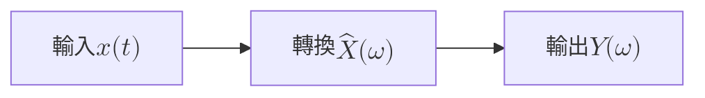

# 📐 LaTeX 數學公式即時預覽

歐拉恆等式 $e^{i\pi} + 1 = 0$ 與高斯積分:
$$
\int_{-\infty}^{\infty}
  e^{-x^2}\,dx = \sqrt{\pi}
$$
泰勒級數展開與旋轉矩陣 $\det R(\theta)=1$:
$$
f(x) = \sum_{n=0}^{\infty}
  \frac{f^{(n)}(a)}{n!}(x-a)^n
$$
$$
R(\theta) = \begin{pmatrix}
  \cos\theta & -\sin\theta \\
  \sin\theta & \cos\theta
\end{pmatrix}
$$
